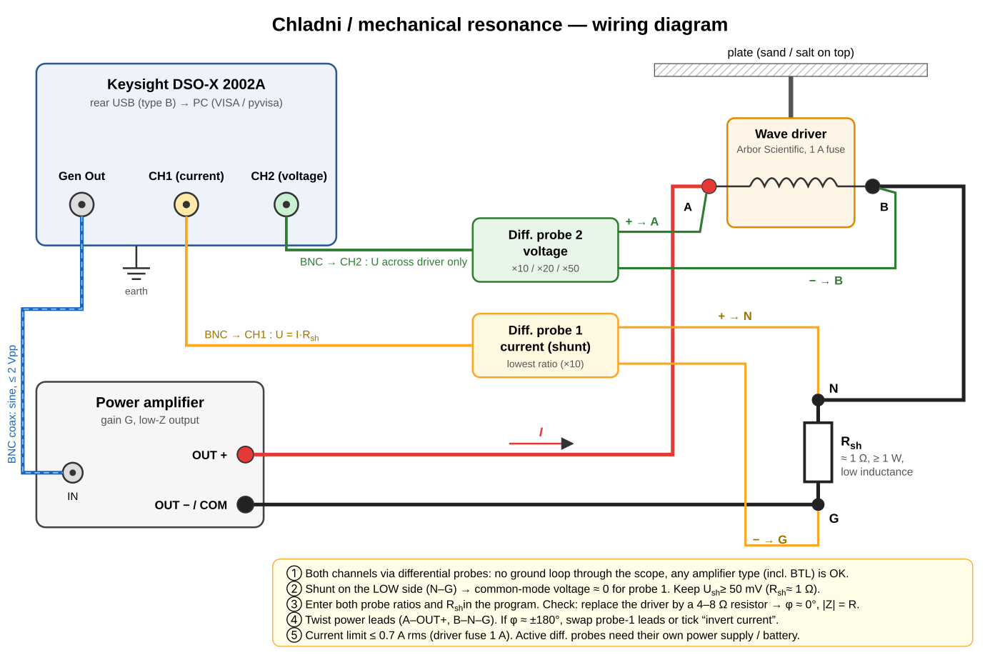

# Chladni plates: electrical detection of mechanical resonances

A single-file Python/PyQt5 application for a teaching-lab Chladni experiment.
A Keysight DSO-X 2000 oscilloscope drives a mechanical wave driver through a power
amplifier, sweeps the frequency, and measures the **current and voltage of the driver**.
Resonances of the plate appear as sharp features in the driver's electrical impedance
and power, so they can be found automatically, and then the Chladni figure at each
resonance can be observed in manual mode.

The method follows Tuan *et al.*, *J. Acoust. Soc. Am.* **137**, 2113 (2015),
[doi:10.1121/1.4916704](https://doi.org/10.1121/1.4916704): the resonance spectrum is
taken as the *net* impedance, i.e. the driver's impedance with the plate minus that without it.


---

## Hardware

| Item | Notes |
|---|---|
| Keysight / Agilent **DSO-X 2002A** (any 2000 X-series with WaveGen) | USB to the PC via the **rear** USB-B port |
| Audio / power amplifier | any type, including bridge (BTL) outputs |
| Mechanical wave driver (Arbor Scientific) | 1 A fuse: the program limits the current to 0.7 A rms by default |
| 2 × **differential probes** | ×10 / ×20 / ×50; active probes need their own supply |
| Shunt resistor R<sub>sh</sub> ≈ 1 Ω, ≥ 1 W, low inductance | on the low side of the driver |
| Plates (square, circular, …) + fine sand or salt | |

## Wiring



* **Gen Out** → amplifier input (BNC coax).
* Amplifier **OUT+ → driver A**, driver **B → N → R<sub>sh</sub> → G → amplifier OUT−**.
* **Diff. probe 1** (+ to N, − to G) → **CH1**: shunt voltage, i.e. current.
* **Diff. probe 2** (+ to A, − to B) → **CH2**: voltage across the driver only.

Because both channels are measured differentially, there is no ground loop through the
oscilloscope and the amplifier output does not need to be grounded.
The editable source of the diagram is [`docs/chladni_wiring.svg`](docs/chladni_wiring.svg).

## Installation

```bash
pip install -r requirements.txt
```

A VISA library is also required. On Windows, install **Keysight IO Libraries Suite**,
which is free. Check that the scope appears in *Keysight Connection Expert* and in the
Device Manager under *USB Test and Measurement Devices*.
Without a system VISA, `pyvisa-py` + `pyusb` + libusb can be used instead.

## Running

```bash
python chladni.py          # with the oscilloscope
python chladni.py --sim    # built-in simulator, no hardware needed
```

At start-up, choose the VISA resource (or *Auto-detect*). If the connection fails, the
program lists every resource it found and why each one was rejected.

## How to use it

### 1. Settings (*Circuit & safety* box)
Enter the **shunt resistance**, both **probe ratios** (the same values as set on the
probes), the coil's **DC resistance** *Re* (measured with an ohmmeter; needed for
*P − I²Re*), the **current limit**, and the maximum generator amplitude.

### 2. Frequency sweep tab
1. **Reference run:** remove the plate, name the run `no plate (reference)` and press
   **START SWEEP** (for example 100–3000 Hz, step 2 Hz).
2. **Plate run:** mount the plate, choose a new run name and sweep again over the same range.
3. Tick **subtract reference (net)** to plot *run − reference* (as in the paper). The
   peak list on the right shows the resonance frequencies.
4. **Fine scan:** click on the plot to set a marker, then press **Fine scan around
   marker** (for example ±10 Hz, step 0.1 Hz).
5. Use **Save CSV…** to save the runs. Every finished run is also auto-saved to `./data/`.

Useful options:
* **hold U rms on driver**: the generator amplitude is adjusted at every point so that
  the driver voltage stays constant.
* **Scope averages / periods in window / settle time**: noise versus speed. The estimated
  sweep duration is shown under the sweep settings.
* **lock zoom**: keeps the axis limits while new points arrive. It switches on
  automatically when you zoom with the toolbar.

### 3. Manual / Chladni pattern tab
Double-click a peak in the list, or type a frequency, then press **OUTPUT ON**. Use the
±0.1 / ±1 / ±10 Hz buttons to tune until the pattern is sharpest. U, I, |Z|, φ and P are
updated continuously. **Log this point** stores the values together with a note
(for example *pattern observed*). The logged points can be saved as CSV.

## What is measured

Both channels are digitised simultaneously (`:DIGitize CHAN1,CHAN2`). Then a sine at the
known generator frequency, *y = a·cos ωt + b·sin ωt + c*, is least-squares fitted to each
record, which works like a digital lock-in amplifier. This is more accurate and less noisy
than the scope's built-in `:MEASure` functions, and any DC offset of the probes drops out.

| Column | Meaning |
|---|---|
| `f` | frequency, Hz |
| `Urms`, `Irms` | driver voltage and current (rms) |
| `Z`, `phase` | \|Z\| = U/I (Ω) and phase of U relative to I (deg) |
| `R`, `X` | Re Z and Im Z (Ω) |
| `P` | active power U·I·cos φ (W) |
| `P_td` | time-domain ⟨u·i⟩, as a cross-check of `P` |
| `P_mech` | P − I²·Re: power that is not dissipated in the coil wire (W) |
| `S`, `PF` | apparent power and cos φ |
| `U_snr`, `I_snr` | fitted amplitude / rms residual (quality of the fit) |
| `wgen_vpp` | generator amplitude used for this point |
| `scale1`, `scale2` | V/div chosen by auto-ranging |
| `flags` | `range` = auto-ranging did not settle, `I-limit` = amplitude was reduced by the current limit, `hold-sat` = voltage hold hit the maximum amplitude |

Each CSV file starts with lines of the form `# run: <name> | {json with all settings}`,
followed by the data with a header row. Saved files can be loaded back with **Load CSV…**.

### A note on physics: peaks or dips?
The driver is a moving coil. Near a mechanical resonance the motion adds a *motional
impedance* to the coil, so **|Z| and R rise and the current falls**. At a fixed generator
voltage, the total power *P* can therefore show either peaks or dips, depending on how
large the motional part is compared with *Re*. Even without a plate, |Z| rises
monotonically with frequency because of the coil inductance.
The most reliable resonance indicators are **net |Z| or R** (with the reference
subtracted) and **P − I²Re**. In the peak finder, tick *dips* when looking for minima.

## Checking the set-up

Replace the driver with an ordinary power resistor (4–8 Ω) and run a short sweep. You
should get **φ ≈ 0°** and **|Z| = R** over the whole band. This checks the probe ratios,
the shunt value and the polarity. If φ ≈ ±180°, swap the leads of probe 1 or tick
*invert current*.

## Troubleshooting

| Symptom | Cause / fix |
|---|---|
| Resource list is empty | Cable plugged into the front USB-A port (that one is for flash drives): use the rear USB-B port. Or the VISA library / Keysight IO Libraries is missing. Check `python -c "import pyvisa; rm=pyvisa.ResourceManager(); print(rm.visalib, rm.list_resources())"` |
| `VI_ERROR_RSRC_BUSY` / timeout | Another program (BenchVue, Connection Expert, another script) is holding the scope |
| φ ≈ ±180° | Current probe reversed: swap the leads or tick *invert current* |
| Noisy current | Increase R<sub>sh</sub> (aim for ≥ 50 mV across it), use the lowest probe ratio, set *Scope averages* to 4–16 |
| Many `I-limit` flags | Reduce the generator amplitude |

## Scripting without the GUI

The instrument and analysis classes can be used directly, for example in Jupyter:

```python
import chladni as c
cfg = c.MeasConfig(r_shunt=1.0, probe1=10, probe2=10, settle_s=0.5)
scope = c.DSOX2000()            # or c.SimulatedScope()
scope.setup(cfg); scope.wgen_on()
rows = [c.measure_point(scope, f, cfg) for f in c.frequency_list(200, 400, step=0.5)]
scope.close()
```

The main SCPI commands used are `:WGEN:*` (generator), `:CHANn:PROB/SCAL/COUP DC`,
`:TRIG:EDGE:SOUR WGEN` (falls back to CHAN2), `:DIG CHAN1,CHAN2`, and
`:WAV:FORM WORD` / `:WAV:PRE?` / `:WAV:DATA?`.

## Repository layout

```
chladni.py              application (GUI + instrument control + analysis)
requirements.txt
docs/chladni_wiring.svg wiring diagram (editable) and .png
docs/screenshot_*.png   example plots (simulator)
data/                   auto-saved runs (git-ignored)
```

## Reference

P. H. Tuan, C. P. Wen, P. Y. Chiang, Y. T. Yu, H. C. Liang, K. F. Huang, Y. F. Chen,
"Exploring the resonant vibration of thin plates: Reconstruction of Chladni patterns and
determination of resonant wave numbers", *J. Acoust. Soc. Am.* **137**(4), 2113–2123 (2015).
